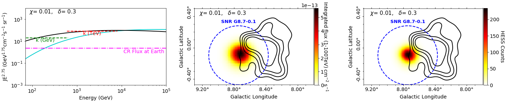

# Mario - Modelling gAlactic gamma-Ray emissIOn



The aim of `mario` is to provide users with proton spectra, gamma-ray spectra, integrated gamma-ray flux maps and simulated excess counts maps for a given gamma-ray source. It is designed for investigating the potential counterparts of high energy gamma-ray sources, as detected through various telescopes including, but not limited to the High Energy Stereoscopic System (H.E.S.S.) and Fermi-LAT. 

## Documentation 
The code, and examples are hosted at https://github.com/Astro-Kirsty/mario


## Installation
The most stable version of `mario` can be easily installed 
with [pip](https://pip.pypa.io/en/stable) via

```
pip install mario
```

## Examples

Examples of how to use `mario` can be found in the examples folder at https://github.com/Astro-Kirsty/mario/tree/master/examples


## Dependencies
`mario` is tested on Python 3.6 and depends on NumPy, SciPy, Matplotlib, GammaPy and spectral_cube
(see requirements.txt for version information).


## License
`mario` is released under the MIT License, see the LICENSE file for the full text.


